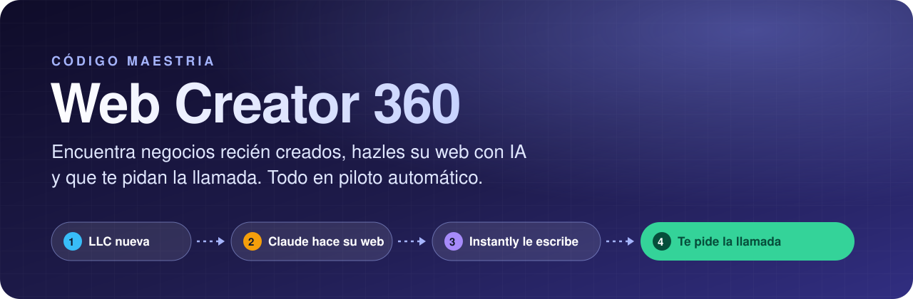
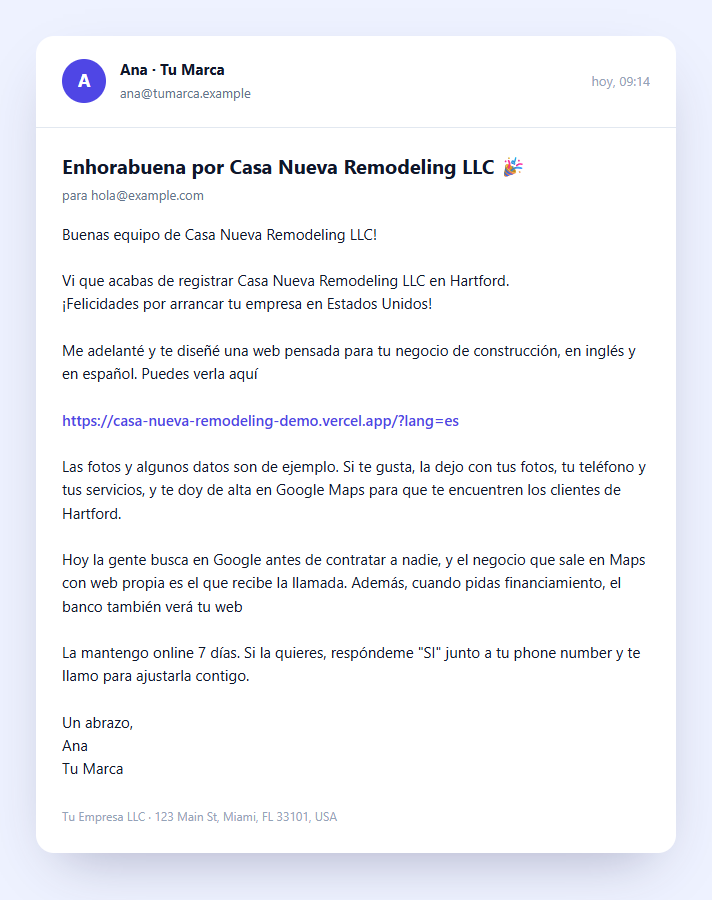
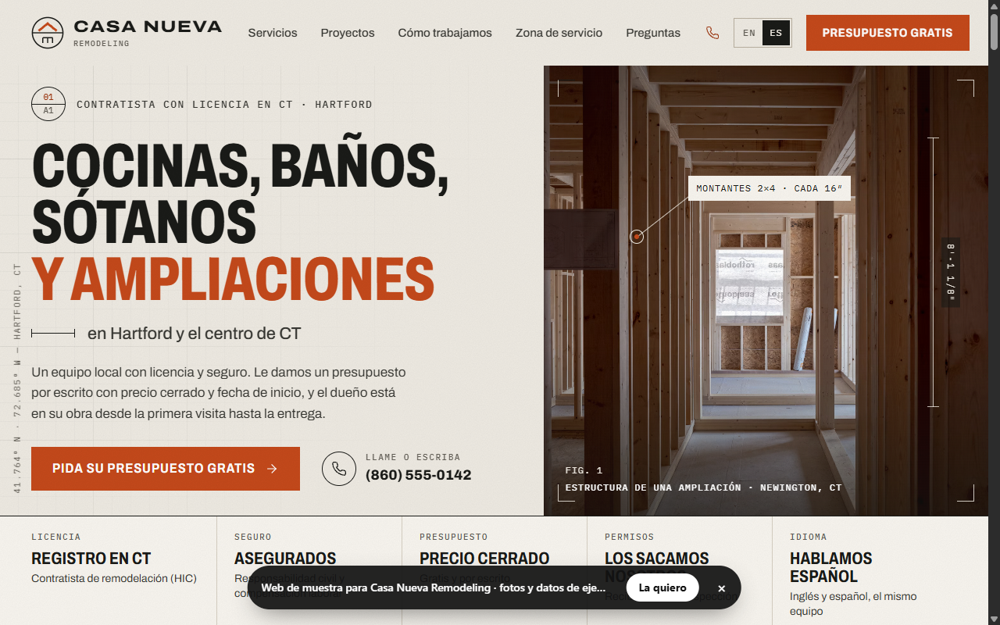
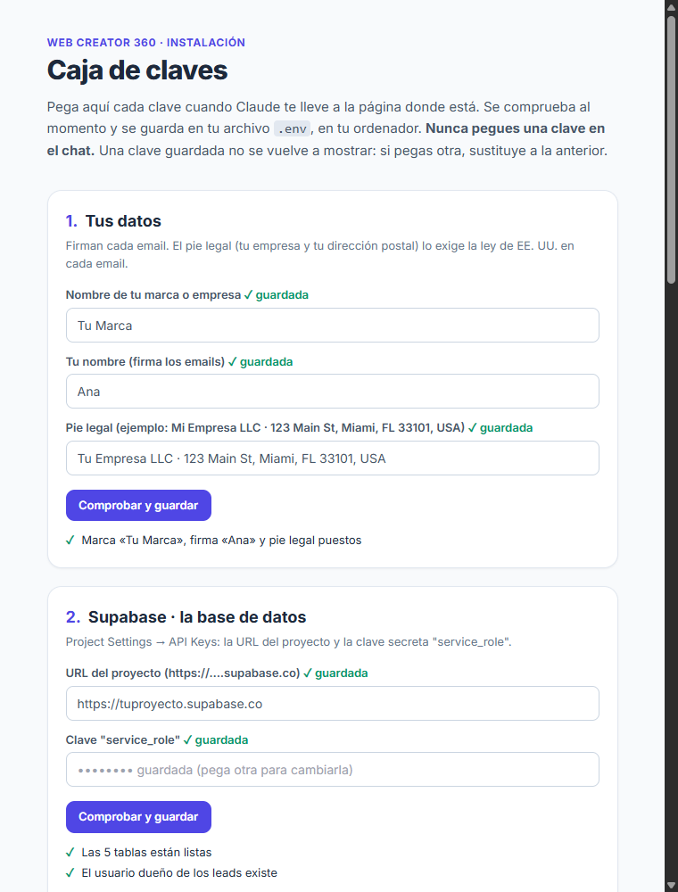
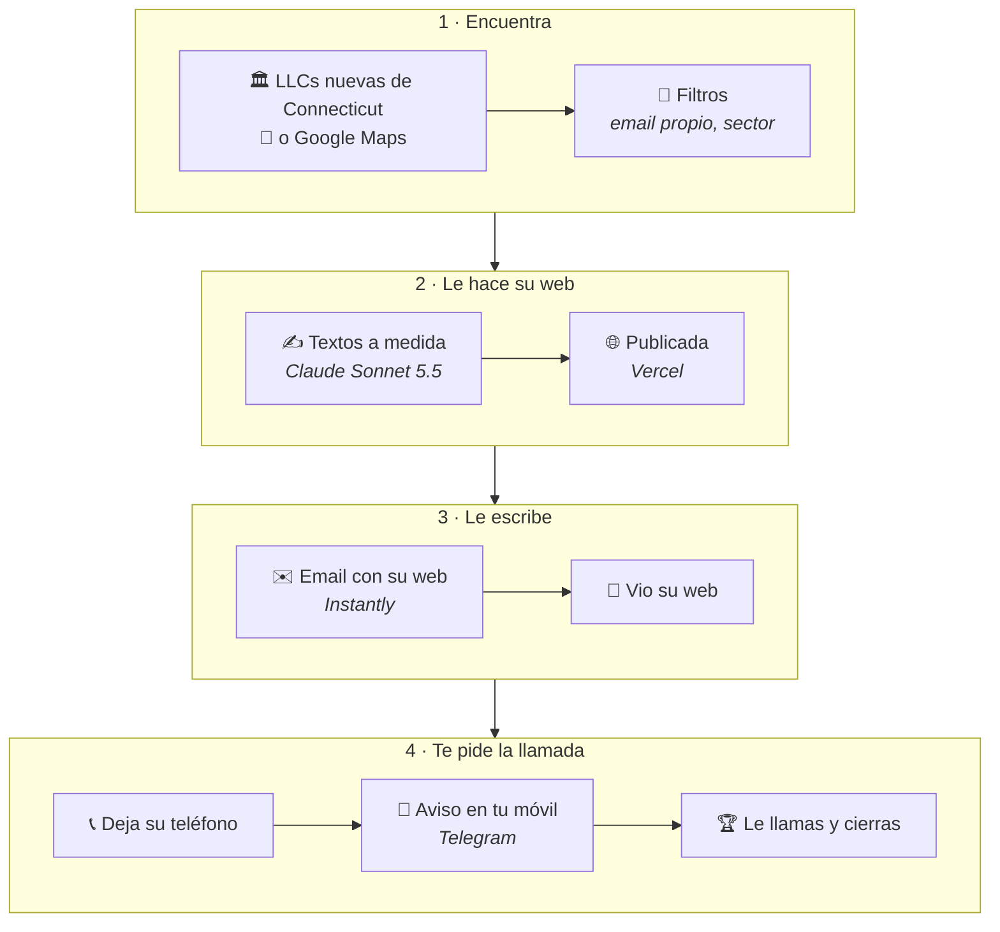
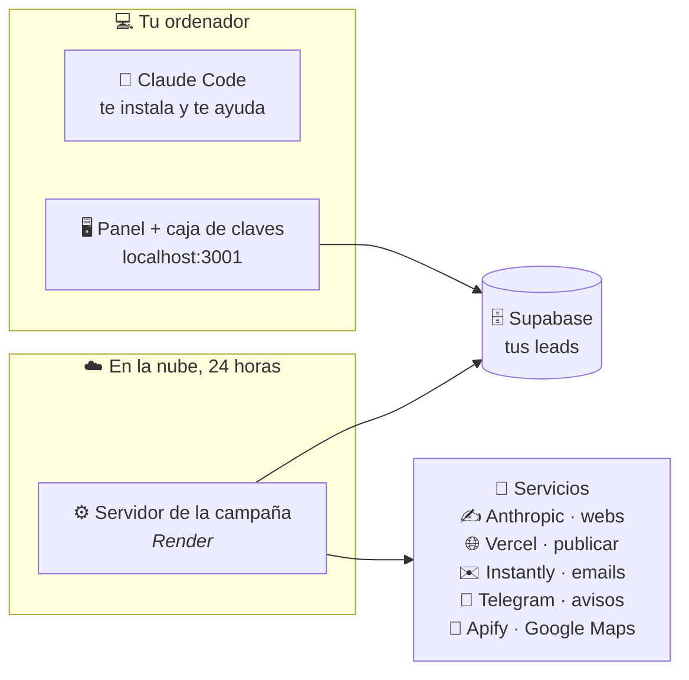
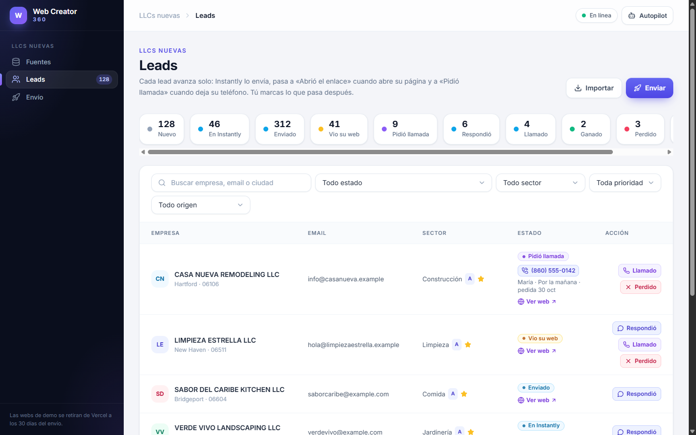

<div align="center">



# Web Creator 360

**Encuentra negocios recién registrados en EE. UU., hazle a cada uno su propia web con IA y envíasela por email. Cuando alguien la quiere, te deja su teléfono y te avisa al móvil.**


<table>
  <tr>
    <th>✉️ El email que recibe el negocio</th>
    <th>🌐 La web que la app le hizo</th>
  </tr>
  <tr>
    <td></td>
    <td></td>
  </tr>
  <tr>
    <td align="center"><sub>Sale de tu buzón, con tu firma y tu pie legal. Instantly lo envía y lo personaliza para cada lead</sub></td>
    <td align="center"><sub>Claude escribió los textos para este negocio y la app la publicó. Hacerla costó <b>0,038 $</b></sub></td>
  </tr>
</table>

<sub>Todo lo de estas imágenes es inventado: el negocio «Casa Nueva Remodeling», sus datos, tu marca y el teléfono 555.</sub>

</div>

---

## 🚀 Instálala en 3 pasos (sin tocar la terminal)

> **Antes de empezar** necesitas:
> - [VS Code](https://code.visualstudio.com) con la extensión **Claude Code**: en VS Code, *Extensiones* → busca «Claude Code» → *Instalar*. Requiere un plan de Claude **Pro o superior**.
> - Una cuenta de [GitHub](https://github.com). Si el repo es privado, tienen que darte acceso con tu usuario.
>
> Claude hace el resto: instala lo que falte, te abre cada web con Playwright y te dice qué pulsar.

**Paso 1 · Crea una carpeta vacía** llamada `web-creator-360` (por ejemplo, en tu Escritorio). En VS Code: **Archivo → Abrir carpeta** y elígela. Abre el panel de Claude Code (el icono ✻).

**Paso 2 · Copia esto y pégalo en Claude:**

```text
Hola Claude. Quiero instalar la app Web Creator 360 en esta carpeta.
1. Si no tengo Git, instálalo tú (Windows: winget install --id Git.Git --exact · Mac: xcode-select --install).
2. Descarga la app aquí mismo: git clone https://github.com/eternitydevzz/web-creator-360.git .
   Si dice que la carpeta no está vacía, hazlo con git init, git remote add origin y git pull origin main.
   Si GitHub me pide entrar, espera a que lo haga en la ventana que se abra.
3. Lee el CLAUDE.md que acabas de descargar y sigue su apartado "Instálame esta app" conmigo, paso a paso.
Háblame en español sencillo. Mis claves las pego yo en la caja de claves: nunca me las pidas en el chat.
```

**Paso 3 · Si Claude te pide abrir una conversación nueva** (lo hace una vez, al instalar Playwright), ábrela en el panel de Claude Code y pega:

```text
instálame esta app
```

Claude te lleva servicio a servicio: abre cada plataforma, tú entras con tu cuenta, copias la clave y la pegas en tu **caja de claves**. Allí cada clave se comprueba al momento y se guarda en tu ordenador.

<table>
  <tr>
    <td width="52%"></td>
    <td>

**🔐 La caja de claves**

- Una página **solo para tu ordenador** (`localhost`): no se puede abrir desde fuera.
- Cada sección tiene **Comprobar y guardar**. Si la clave no vale, te dice por qué y no la guarda.
- Una clave guardada **no se vuelve a mostrar**.
- Claude nunca la ve: **las claves no pasan por el chat**.
- Las tablas de Supabase las crea Claude, y tus campañas de Instantly y tu servidor de Render salen de un botón.

</td>
  </tr>
</table>

---

## ✨ Qué hace

- 🏛️ **Busca negocios recién creados**: LLCs nuevas de **Connecticut** con dueño latino (emails en español) y, si quieres, negocios **sin web en Google Maps** de Florida, Texas y New Jersey (en inglés).
- 🔎 **Se queda con los buenos**: con email propio (no el de una gestoría ni uno compartido), actividad real y su sector.
- ✍️ **Le hace su web**: 7 plantillas hechas a mano (construcción, limpieza, jardinería, comida, belleza, barbería y general) y Claude escribe los textos para ese negocio. Bilingüe para las LLCs latinas, solo en inglés para Google Maps.
- 🌐 **La publica en Vercel** y la retira a los 30 días.
- ✉️ **Le escribe con Instantly**, desde tus buzones, con tu firma y el pie legal que exige la ley de EE. UU.
- 👀 **Sabe quién abre su web** y quién pide la llamada.
- 📲 **Te avisa por Telegram** cuando alguien deja su teléfono.
- 🤖 **Piloto automático**: busca leads cada día a las 7:00 (hora de Nueva York) y envía cada 3 horas. Lo enciendes y lo apagas desde el panel.

## 🔄 Cómo funciona



Cada lead avanza solo de una casilla a la siguiente. Tú solo marcas lo que pasa después de la llamada: **Llamado**, **Ganado** o **Perdido**.

## 🏗️ Dónde corre cada cosa



El **servidor de Render** hace lo automático aunque apagues tu ordenador: buscar leads, crear sus webs, enviarlos y mirar las respuestas. El **panel** de tu ordenador es para ver tus leads y hacer las cosas a mano.

## 🖥️ El panel



<sub>Datos de ejemplo. Cada lead enseña su estado, su web («Ver web») y, si pidió la llamada, su teléfono y cuándo prefiere que le llames.</sub>

## 🪄 Prompts listos para copiar

Abre Claude Code en la carpeta de la app y pega el que necesites:

| Para… | Pega esto en Claude |
|---|---|
| ✅ Comprobar que todo va | `Comprueba que todo funciona con npm run doctor y explícame cada línea roja o amarilla.` |
| 🖥️ Abrir el panel | `Arranca el panel y ábremelo en el navegador.` |
| 🏛️ Buscar LLCs nuevas | `Busca las LLCs nuevas de Connecticut, primero en modo prueba (--dry-run), y dime cuántas entrarían.` |
| ✉️ Ver el email | `Enséñame el email que van a recibir los negocios (npm run leads:email-template).` |
| ✍️ Crear webs | `Crea las webs de los 3 leads nuevos más recientes y dame sus enlaces.` |
| 📤 Enviar | `Envía a Instantly los leads nuevos que ya tienen su web y dime cuántos salieron.` |
| 🔁 Mirar respuestas | `Mira en Instantly qué ha pasado con los emails enviados (npm run instantly:poll).` |
| 🟢 Pasar a enviar de verdad | `Ya lo he probado con mi email. Quiero salir del modo prueba y enviar de verdad.` |
| ⬆️ Actualizar la app | `Actualiza la app a la última versión con git pull y npm ci, y dime si tengo que hacer algo más.` |
| 🆘 Algo falla | `Algo no funciona. Revisa con npm run doctor, dime qué pasa y qué tengo que hacer.` |

> 🧪 **Empieza en modo prueba** (`OUTREACH_DRY_RUN=true`): la app hace todo menos enviar los emails. Pruébala con tu propio email y, cuando estés seguro, usa el prompt de «Pasar a enviar de verdad».

## 💸 Lo que necesitas (y lo que cuesta)

| Servicio | Para qué | Coste |
|---|---|---|
| 🤖 **Claude Code** | Te instala la app y te ayuda a usarla | Plan de Claude **Pro o superior** ([fuente](https://code.claude.com/docs/en/setup)) |
| ✍️ **Anthropic API** | Escribe cada web | Pago por uso: **0,038 $** costó la web de arriba. La app calcula hasta ~0,14 $ por web. Necesita saldo |
| 🗄️ **Supabase** | Guarda tus leads | Plan gratis. Ojo: deja **2 proyectos activos** por cuenta |
| 🌐 **Vercel** | Publica las webs | **Gratis para probar**. Para enviarlas a negocios, **Pro: 20 $/mes**, porque el plan gratis es solo para uso no comercial ([normas](https://vercel.com/docs/limits/fair-use-guidelines), [precio](https://vercel.com/pricing)) |
| ✉️ **Instantly** | Envía los emails | Plan **Growth: 47 $/mes** ([precios](https://instantly.ai/pricing)), más tus buzones. Si no tienes, Claude te guía para pedirlos dentro de Instantly. Hay que **calentarlos 2 semanas** antes de enviar |
| ⚙️ **Render** | El servidor que trabaja 24 h | **Starter: 7 $/mes** ([precio](https://render.com/hosting/nodejs)). El gratis se duerme tras 15 minutos sin visitas y se paran las tareas automáticas ([fuente](https://render.com/docs/free)) |
| 📲 **Telegram** *(opcional)* | Te avisa al móvil | Gratis |
| 📍 **Apify** *(opcional)* | Solo para la campaña de Google Maps | El plan gratis (5 $/mes) se gasta en **unos 2 días** con Maps |
| 🐙 **GitHub** | Descargar la app y crear tu servidor en Render | Gratis |

Cada alumno usa **sus propias cuentas, su marca y sus buzones**. Tus claves viven en el archivo `.env` de tu ordenador, que **nunca se sube a GitHub**.

## 🪟 Windows y 🍎 Mac

| | 🪟 Windows 10 / 11 | 🍎 Mac |
|---|---|---|
| **Estado** | ✅ Probado | ⚠️ Sin probar todavía |
| **Instalar** | Los 3 pasos de arriba | Los 3 pasos de arriba |
| **Node.js** | Claude lo instala con `winget` si falta | Claude te abre nodejs.org para descargarlo |
| **Git** | Claude lo instala con `winget` | Claude abre el instalador de Apple (`xcode-select`) |
| **Playwright** | Claude lo añade a Claude Code | Claude lo añade a Claude Code |

## 🚫 Lo que no hace

- **No envía nada el primer día.** Empieza en modo prueba, y los buzones nuevos de Instantly necesitan unas 2 semanas de calentamiento.
- **No llama por ti.** Te da el teléfono y la hora que prefiere el cliente; la llamada y la venta son tuyas.
- **No busca en cualquier sitio.** Las LLCs son solo de Connecticut, y Google Maps cubre Florida, Texas y New Jersey.
- **No da por buenos los datos de ejemplo.** Las fotos y algunos datos de cada web son de muestra, y la propia web lo dice en su barra.
- **No sale gratis.** Mira la tabla de costes: Instantly, Render y Vercel Pro son de pago.

## 📁 Estructura

```
src/            el panel (index.js), el servidor de la campaña (campaign-server.js) y su lógica
public/         las páginas del panel y la caja de claves
templates/      las 7 plantillas de web, hechas a mano
scripts/        las órdenes (npm run doctor, ct:ingest, leads:push…)
tests/          las pruebas (npm test)
docs/img/       las imágenes de este README
CLAUDE.md       el manual de la app para Claude: así sabe instalártela
render.yaml     cómo se monta el servidor en Render
```

## 🧪 Versiones probadas

Windows 11 · Node.js **24.16** · Claude Code **2.1.302** · modelo de las webs **Claude Sonnet 5.5** (`claude-sonnet-5-5`).
